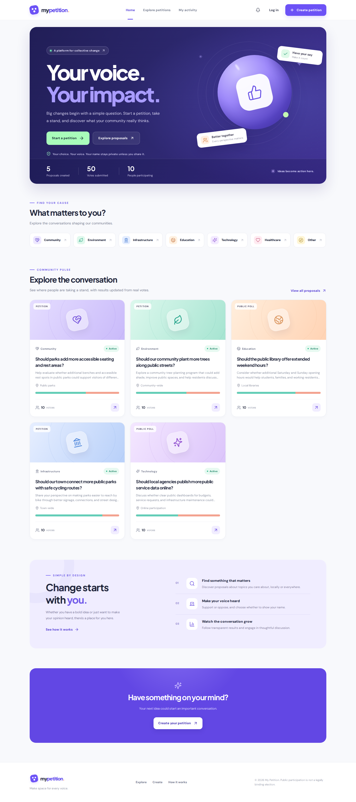
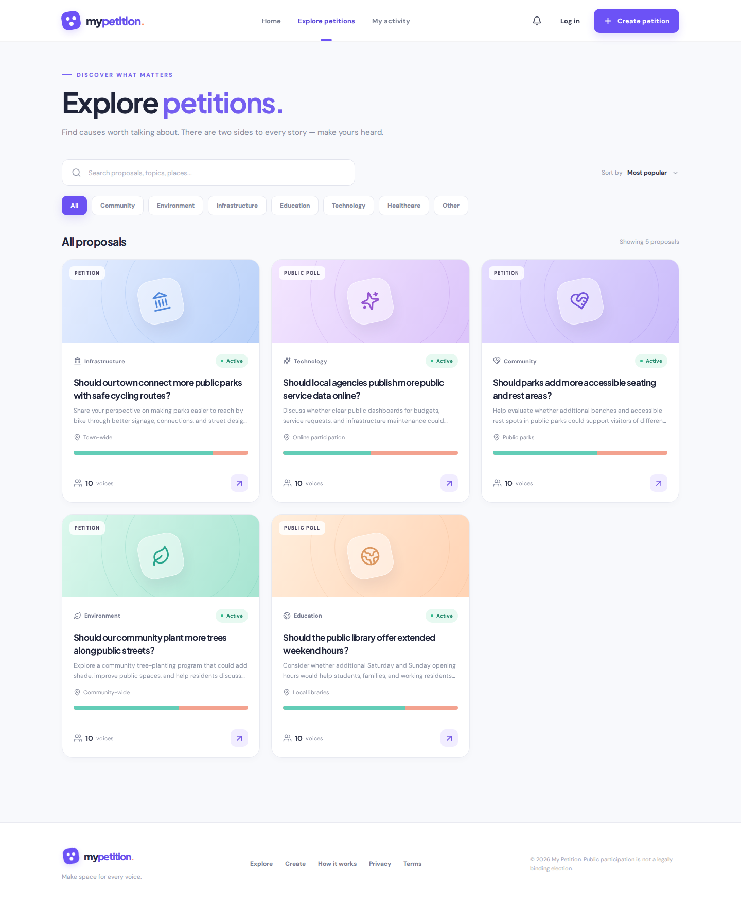
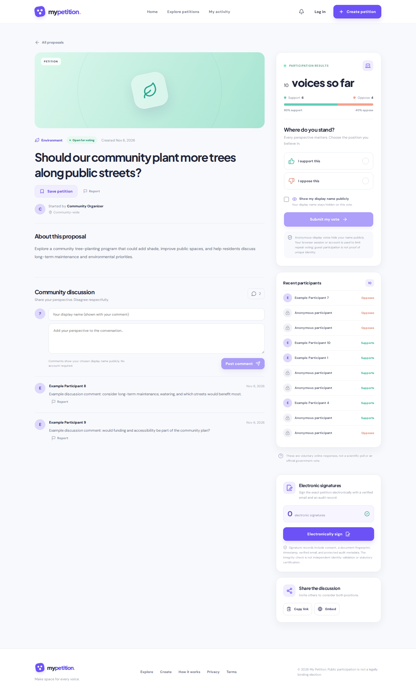
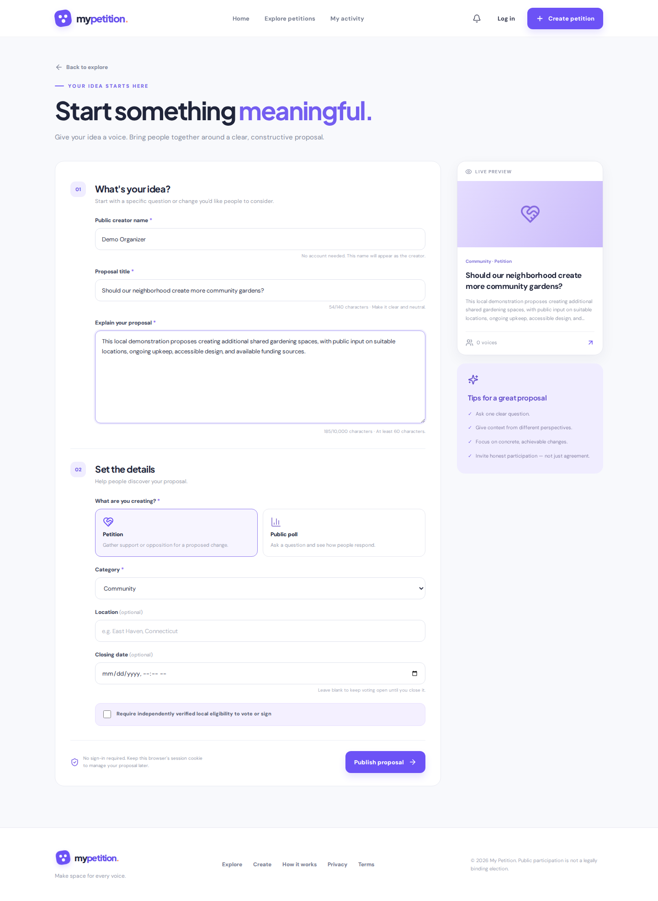
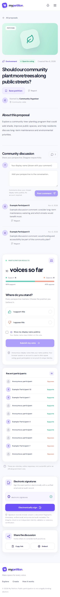

  

  # My Petition
  **Your voice. Your impact.**

  A beautifully designed platform for petitions, community proposals, and public opinion polls.

  
  
  
  

  **[Getting started](#quick-start) · [How to use](#how-to-use-my-petition) · [Screenshots](#screenshots) · [Deployment](#deploy-to-cloudflare)**

> [!IMPORTANT]
> **My Petition is an early alpha, not a public election or legally certified signature service.** People can participate without an account. Email verification is required for traceable electronic signatures, but is not proof of legal identity or local residency. Guest vote counts represent voluntary online responses, not verified unique individuals or a representative survey. A production launch needs further security, identity, privacy, and moderation work.

## Screenshots

Screenshots below are captured automatically from the **running React application** with a **local, synthetic demo dataset**—not from a design mockup and not from live public submissions. They are refreshed by the [UI screenshots workflow](.github/workflows/screenshots.yml).

### Home and discovery

### Proposal details and creation

| Proposal page | Create a petition |
|---|---|
|  |  |

### Mobile experience

## What is My Petition?

My Petition lets communities discuss a clear question, record support and opposition, and optionally collect electronic signatures. It combines a responsive participation experience with transparent, auditable workflows.

- **No registration for participation.** Create a petition, vote, comment, or start email verification for an e-signature as a guest. A guest cookie associates activity with the current browser; clearing cookies or changing devices may make that activity inaccessible.
- **Optional account to save petitions.** Create an account or log in to build a personal saved collection. Accounts do not automatically merge prior guest activity.
- **Petitions and polls.** Petition pages have a separate opt-in electronic signing experience. Poll pages collect support or opposition.
- **Optional name display.** Guest voters choose whether to show a display name; comments always show a chosen public name. Names in ordinary votes can be hidden, but vote storage is **not cryptographically anonymous**.
- **Tamper-evident electronic signatures.** Verify an email address, enter a legal name, explicitly consent to the petition, and receive a private JSON receipt. New records include a timestamp, petition fingerprint, protected metadata and a server-held HMAC integrity seal. Anyone with the unpredictable receipt ID can check integrity without seeing the signer name or email. This is **not independent identity verification or legal certification**.
- **Local participation controls.** Creators can limit votes and signatures to independently approved local participants. Locality claims begin as *pending*, and a moderator must separately verify eligibility using documented evidence.
- **Share, embed, and follow.** Copy links, use the browser share sheet, copy iframe embed markup, receive in-app notifications, or save petitions with an account.
- **Community safety.** Report proposals or comments for review; an allowlisted, email-verified moderator may review reports and hide content.

### How the platform works

| Feature | Guest, no account | Registered account | Additional requirement |
|---|---|---|---|
| Browse proposals and results | Yes | Yes | None |
| Create petitions or polls | Yes | Yes | Public creator display name for guests |
| Vote support / oppose | Yes | Yes | Verified local eligibility when enabled |
| Comment | Yes | Yes | Public display name |
| Electronically sign petitions | Yes | Yes | Verified email, full name and explicit consent |
| Save a petition | No | Yes | Sign in |
| Receive in-app activity notifications | Guest session | Yes | An active session |
| Moderation dashboard | No | Eligible moderator | Verified email on allowlist |

## How to use My Petition

### 1. Browse or explore a proposal

Open the homepage and select **Explore petitions**. Browse the proposal cards or filter by topic and search by title, description, or location. Each card shows support and oppose counts; they come from stored responses, not fabricated live statistics.

### 2. Create a petition or poll

Select **Create petition**. If you are not signed in, supply a public creator display name. Add a descriptive question (12–140 characters), explain the context (60–10,000 characters), select **Petition** or **Public poll**, and choose the category. A location label and closing date are optional.

If the proposal requires independently verified local voters, enable that option and supply the relevant city/town and state/region. Click **Publish proposal**. Keep the browser's guest cookie if you want to manage the proposal later.

### 3. Vote on a proposal

Open the proposal. Select **I support this** or **I oppose this**. You can choose whether your display name appears next to your position; anonymous display is the default. Click **Submit my vote**. A browser guest session or account ties the response to a participant record and lets that participant update the vote while the proposal is open.

**Important:** Guest-cookie enforcement is not one-person-one-vote identity verification. A different browser, cleared cookies, or multiple devices can create duplicate responses.

### 4. Electronically sign a petition

Only petitions have a signing panel.

1. Open a petition and select **Electronically sign**.
2. Submit an email address and enter the six-digit code sent to that address.
3. Enter your full legal name and review the exact petition before signing.
4. Optionally make your signer name public. Check the explicit electronic-signature consent box.
5. Confirm the signature and **Download your signature receipt**. Keep the receipt private—it includes your name and email address. If you explicitly opt in, your full legal name can appear in the public signer directory.

A signature is recorded separately from a support/oppose vote. Its database record includes the verified email, exact document hash, consent version, signing timestamp, and protected connection fingerprints. **Email ownership is not proof of identity; this is not qualified/digital-certificate signing or government certification.**

### 4a. Verify a signature receipt

1. Download the private receipt and open its **Verify integrity of receipt** link, or visit `/verify-signature`.
2. Enter the receipt UUID from `receipt.id`.
3. The server checks whether the stored signing evidence still matches the original integrity seal and returns the petition link and document fingerprint.
4. The public verification response intentionally excludes the signer's name, email, account ID, IP fingerprint, and private connection metadata.

New signatures use a keyed HMAC seal protected by `AUDIT_HASH_SECRET`. Previous signatures without an integrity seal are labeled **unsealed**, never cryptographically verified. Losing or rotating this secret without a managed migration can make older seals unverifiable.

**Limits:** The same site operator controls the database and seal key. This is server-side tamper evidence, not independent certification. It does not establish the person's legal identity, physical residence or eligibility. Statutory petition rules may not accept these signatures.

### 5. Request local verification, when required

For a locality-restricted proposal, first verify your email, then submit your city, state/region and postal code. The request is marked **pending** until a moderator checks independent evidence and records the verification method. Merely providing a city or email never makes a participant verified.

### 6. Share and save

Use **Share the discussion** to copy a direct URL, native share action, or HTML iframe embed code. The embed shows aggregate participation and links back to the original proposal. **Save petition** prompts for sign-in when needed; saved petitions appear under **My activity**.

### 7. Report content

Use **Report** on a proposal or comment. Select an issue category and optionally add details. Reported content enters a moderator review queue. Authorized moderators can dismiss reports or hide reported material. Reports do not change vote counts.

## Quick start

**Requirements:** Node.js 22 or newer, npm, and a clone of this repository. You do **not** need a Netlify project or a paid domain for local development.

~~~bash
git clone https://github.com/theworker02/my-petition.git
cd my-petition
npm install
npm run db:local
npm run dev
~~~

Open **http://127.0.0.1:5173** in your browser. Vite serves the React UI and proxies the API to a local Cloudflare Worker at **http://127.0.0.1:8787**.

The sample D1 UUID in `wrangler.jsonc` is intentionally a placeholder for **local** development; it must be replaced for remote deployment. Your local database and development environment variables are excluded from Git.

For a clean frontend compile and backend configuration check:

~~~bash
npm run typecheck
npm run build
npm run db:local
npx wrangler deploy --dry-run
npm run test:smoke
~~~

### API smoke tests

Run `npm run test:smoke` after a local database migration and frontend build. The suite launches a local Cloudflare Worker and validates guest participation, vote changes, public comments, duplicate reports, optional saved proposals, local eligibility gates, and traceable signing. For signatures, it inserts a synthetic verified-email fixture in local D1 and uses a temporary test-only audit secret: **it never sends actual email or touches production records**.

### Run a local demo dataset (screenshots/testing only)

This fixture populates example proposals, fake participants, comments and votes in your **local** database:

~~~bash
npx wrangler d1 execute my-petition-db --local --file=fixtures/screenshot-seed.sql
~~~

**Never run the screenshot seed against production.** To regenerate the screenshots, run the [Capture UI screenshots](.github/workflows/screenshots.yml) GitHub Actions workflow, which starts the app locally and captures actual Chromium pages. The generated images are committed to `docs/screenshots/`.

## Deploy to Cloudflare

This app uses one Cloudflare Worker for API routes **and** static assets, plus a D1 database. No separate Netlify project is needed.

1. Authenticate with Cloudflare: `npx wrangler login`.
2. Create the database: `npx wrangler d1 create my-petition-db`.
3. Copy the real **database ID** from the CLI into `wrangler.jsonc`.
4. Apply schema migrations: `npm run db:remote`.
5. Configure the required secrets and production safeguards (see below).
6. Build and deploy: `npm run deploy`.

The public site is not automatically deployed from this repository. Domain configuration, monitoring, and production security review remain separate tasks.

### Email verification and signing configuration

The backend sends one-time email codes via [Resend](https://resend.com/). To activate email verification and signatures, supply the following values to the Worker environment:

| Variable | Where | Purpose |
|---|---|---|
| `RESEND_API_KEY` | Secret | Sends verification emails |
| `MAIL_FROM` | Environment value | Verified sender address in Resend |
| `EMAIL_OTP_SECRET` | Secret | Protects one-time code hashes |
| `AUDIT_HASH_SECRET` | Secret | Protects signed IP / abuse-control evidence |
| `TURNSTILE_SITE_KEY` | Public configuration | Cloudflare Turnstile site key for account registration |
| `TURNSTILE_SECRET` | Secret | Cloudflare Turnstile challenge validation |
| `MODERATOR_EMAILS` | Restricted configuration | Comma-separated verified email addresses allowed to moderate |

Example for secret fields:

~~~bash
npx wrangler secret put RESEND_API_KEY
npx wrangler secret put EMAIL_OTP_SECRET
npx wrangler secret put AUDIT_HASH_SECRET
npx wrangler secret put TURNSTILE_SECRET
~~~

Use cryptographically random values for hash secrets (for example `openssl rand -hex 32`). Provide `MAIL_FROM`, `TURNSTILE_SITE_KEY`, and `MODERATOR_EMAILS` through appropriate, non-secret Worker configuration. A moderator must have successfully verified an email address matching the allowlist before accessing `/moderation`.

**If the mail provider or audit secret is not configured, the app refuses to send verification codes or record e-signatures.** Those features should not be advertised as fully operational until configured and tested end-to-end.

## Project layout

~~~text
my-petition/
├── src/
│   ├── App.tsx            # Pages, authentication UI, voting and proposal views
│   ├── features.tsx       # Signatures, verification, sharing, moderation, notifications
│   ├── api.ts             # Typed API client
│   ├── styles.css         # Core design system and responsive UI
│   └── features.css       # Component styling
├── worker/index.ts        # Cloudflare Worker API (Hono)
├── migrations/            # Versioned D1 migrations and signature integrity seal
├── shared/signature.ts     # Versioned e-signature consent text used by UI and API
├── fixtures/              # Local-only example data for screenshots
├── scripts/               # Automated Chromium screenshot capture
├── docs/screenshots/      # Actual captured UI images (generated)
├── .github/workflows/     # CI and screenshot automation
├── wrangler.jsonc         # Worker and D1 configuration
└── package.json           # Local commands and dependencies
~~~

## Core API

| Endpoint | Purpose |
|---|---|
| `GET /api/proposals` | Browse and search |
| `GET /api/proposals/:slug` | Proposal, votes, participant display and comments |
| `POST /api/proposals` | Guest or registered proposal creation |
| `POST /api/proposals/:slug/vote` | Submit or update a response |
| `POST /api/proposals/:slug/sign` | Record consent-based electronic signature |
| `GET /api/signatures/:id/verify` | Verify a receipt seal without disclosing signer identity |
| `GET /api/proposals/:slug/signature-receipt` | Signer's private receipt |
| `POST /api/verification/email/request` | Email a verification code |
| `POST /api/verification/email/confirm` | Verify a code |
| `POST /api/verification/location/request` | Submit pending local eligibility request |
| `POST /api/proposals/:slug/save` | Save a petition (requires account) |
| `GET /api/me/activity` | Created, voted, and saved proposals |
| `GET /api/me/notifications` | In-app notification list |
| `POST /api/reports` | Report a proposal or comment |
| `GET /api/moderation/queue` | Moderator-only review queue |

## Privacy, trust and limitations

- **Anonymous display ≠ secret ballot.** A name-hidden vote remains linked to an internal participant ID. E-signature evidence must remain private and only accessible to authorized parties.
- **Guest identity is weak.** A cookie-based visitor can register again in another browser. Scores and tallies are advisory.
- **Email verification is not identity verification.** Owning an email inbox does not establish legal name, residency, or uniqueness.
- **Legal treatment of signatures varies.** The app records intent and sealed evidence, but server-held integrity seals are not an independent attestation. They do not provide qualified signatures, independently verified identity or automatic statutory petition eligibility.
- **Local verification is not automated.** Moderators need a reliable independent identity/residency-check process and privacy-safe evidence handling.
- **Public launch is not yet approved.** Before production, add stronger request throttles, fraud protection, security tests, account recovery, guest-to-account migration, consent and retention policies, account deletion, complaint appeals, backups, abuse monitoring, and a comprehensive accessibility review.

## Contribution and development principles

Avoid fabricated public participation totals or misleading endorsements. Make support and opposition equally accessible, and never use persuasive UI patterns to steer users toward a particular position. Build accessibility, mobile responsiveness, privacy, and moderation into new features by default.

**Maintainer:** [theworker02](https://github.com/theworker02) · **Status:** Alpha / active development
